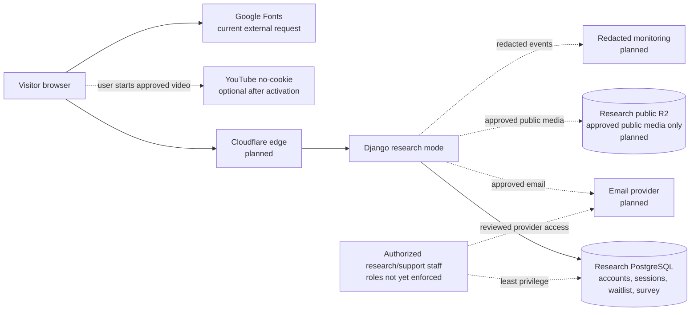
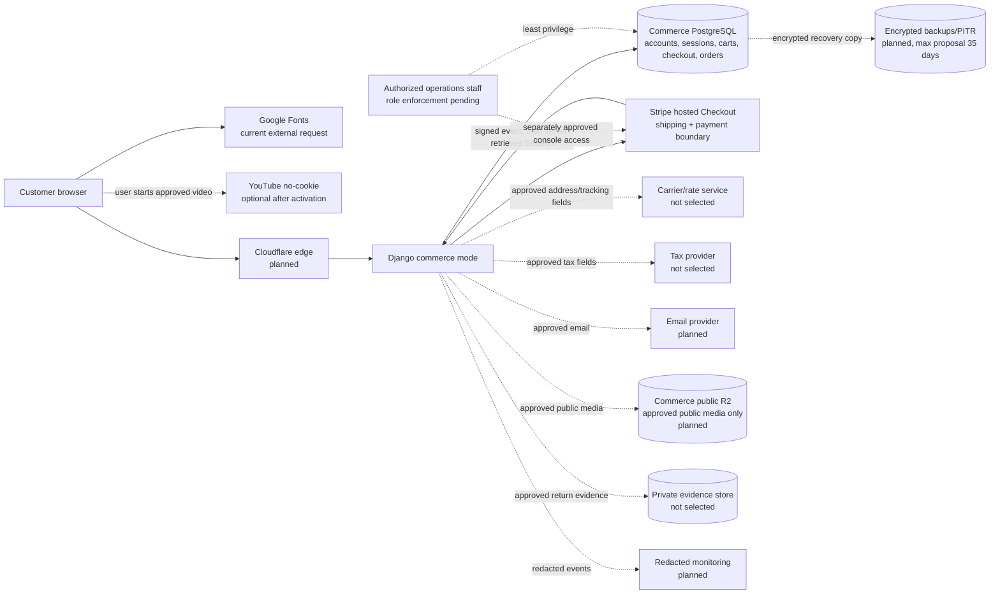

# Research and Commerce Data Flows

**Policy:** `TJ-PRIV-001` `0.1-draft`
**Status:** Current repository behavior plus explicitly labeled planned services

These diagrams show trust and storage boundaries, not deployed infrastructure.
Dashed nodes are planned or conditional. Provider selection and live validation
remain A2.3/A9 work.

## Research mode

Research constraints:

- No cart, order, payment, reservation, Stripe, or commerce-provider path.
- Survey drafts live only in the database session and completed responses are
  created without user/session linkage.
- Waitlist email and optional first name remain directly identifiable.
- No raw research record may enter the commerce database.

## Commerce mode

Commerce constraints:

- Raw card data remains at Stripe; TreadJoy stores only bounded payment,
  refund, amount, currency, state, and reconciliation identifiers.
- Shipping address enters through Stripe-hosted Checkout and is persisted only
  after eligible retrieved-Session verification creates a paid/review order.
- Public media storage is not suitable for returns evidence, exports, customer
  uploads, rights contracts, backups, or incident evidence.
- No raw commerce record may enter research, CI, source control, or content
  production.

## Cross-mode aggregate rule

Any future cross-mode report must be produced from an approved allowlist of
non-identifying aggregate metrics. Before export, remove direct identifiers,
session/internal/provider IDs, free text, precise timestamps/locations, and
small cohorts. The report owner records source data-class IDs, aggregation
logic, minimum cohort rule, purpose, recipient, and retention.
